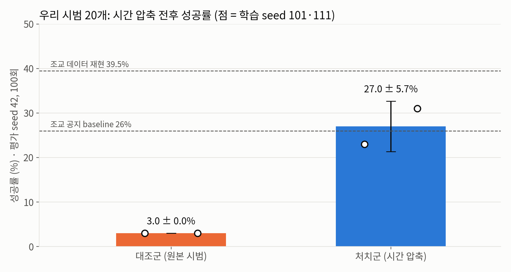
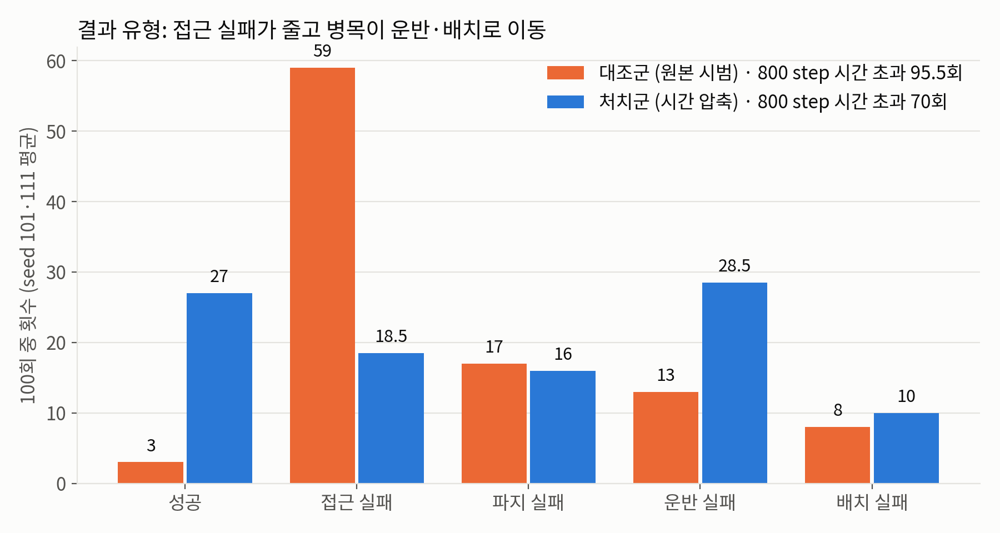
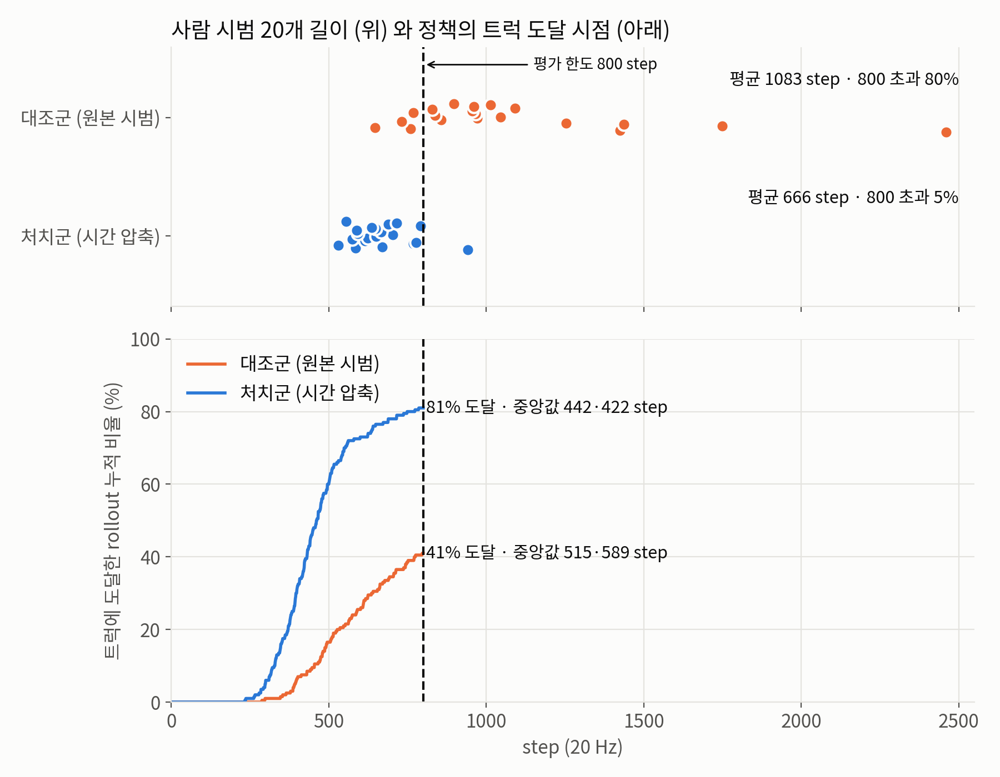

# 실습과제 #2 — Agibot Toy2Box 모방학습 성공률 향상 연구 (8조)

> **한 줄 결론**: 우리 키보드 시범은 너무 느려서(평균 1,083 step) 평가 시간 한도(800 step)를 넘었고, BC 정책은 그 속도를 그대로 따라 해 시간이 모자랐다. 같은 시범 20개의 시간축만 압축하자 성공률이 **3.0 ± 0.0% → 27.0 ± 5.7%** 로 올랐다.

이 저장소는 조교가 제공한 IsaacLab 수업 저장소에 우리 과제 결과물을 `assignment2/` 폴더로 더한 것이다. 수업 저장소의 원래 파일은 바꾸지 않았다(원래 README는 [`README_IsaacLab_original.md`](README_IsaacLab_original.md)).

## 제출물 위치
| 항목 | 위치 |
|---|---|
| 최종 가중치 (학습 seed 101) | `assignment2/weights/seed101/model_epoch_2000.pth` |
| 최종 가중치 (학습 seed 111) | `assignment2/weights/seed111/model_epoch_2000.pth` |
| 평가 명령 | [`assignment2/play_commands.txt`](assignment2/play_commands.txt) |
| 상세 실험 보고 | [`assignment2/README.md`](assignment2/README.md) |

평가 명령 예 (저장소 루트에서):
```bash
./isaaclab.sh -p scripts/imitation_learning/robomimic/play.py \
  --task Isaac-Place-Toy2Box-Agibot-Right-Arm-RmpFlow-v0 \
  --checkpoint ./assignment2/weights/seed101/model_epoch_2000.pth \
  --num_rollouts 100 --horizon 800 --seed 42 --headless
```

## 저장소 구조 (`assignment2/`)
| 폴더 | 내용 |
|---|---|
| `weights/` | 최종 모델 2개(seed 101·111)와 학습 설정 `config.json` |
| `datasets/` | 우리 사람 시범 20개 원본, annotate 파일(대조군 소스), 시간 압축 파일(처치군 소스) |
| `figures/` | 발표용 그림 3장 |
| `scripts/` | 우리가 추가한 스크립트(수업 스크립트 사본 + 새 스크립트). 순서는 [`scripts/README.md`](assignment2/scripts/README.md) |
| `play_commands.txt` | 최종 모델 평가 명령 2개 |
| `README.md` | 진단·가설·설계·결과·한계 상세 |

## 결과 (평가 seed 42, 100회, horizon 800, epoch 2000)
| 조건 | seed 101 | seed 111 | 평균 ± 표준편차 |
|---|---|---|---|
| 조교 시범 20개 (baseline 재현, 참고) | 35 | 44 | 39.5 ± 6.4% (조교 공지 26%) |
| 우리 시범 20개 원본 (대조군) | 3 | 3 | 3.0 ± 0.0% |
| 우리 시범 20개 시간 압축 (처치군) | 23 | 31 | **27.0 ± 5.7%** |

- 트럭에 닿은 비율 41% → 81%, 닿기까지 걸린 step 중앙값 515·589 → 442·422.
- 결과 보기 전에 정한 판정 기준(평균 ≥ 14%, 각 seed ≥ 9%, 도달 시간 또는 도달률 개선)을 모두 충족 → **가설 지지**.





## 재현 절차
조교 환경(conda env `lerobot-arena`, 저장소 루트)을 기준으로 한다. 시간은 이 과제를 실행한 서버(RTX 6000 Ada 1장) 기준.

| 단계 | 스크립트 | 예상 시간 |
|---|---|---|
| 1. annotate (20개) | `assignment2/scripts/annotate_keep_nosignal.py --auto` | 약 30분 |
| 2. grasp 경계 2개 규칙 지정 | `assignment2/scripts/set_rule_grasp_boundary.py --dist 0.06` | 1분 미만 |
| 3. 시간 압축 (처치군 소스) | `assignment2/scripts/time_transform_hdf5.py compress --protect_signals` | 1분 미만 |
| 4. Mimic 생성 (성공 500, 조교 명령과 동일) | `scripts/imitation_learning/isaaclab_mimic/generate_dataset.py` | 조건당 약 3–4시간 |
| 5. BC 학습 (seed 101·111) | `assignment2/scripts/train_seeded.py --seed 101` / `111` | 모델당 약 40분 |
| 6. 평가 | `assignment2/play_commands.txt` (기본 play.py) | 모델당 약 1.5시간 |

1–3단계 결과물은 `assignment2/datasets/`에 이미 들어 있어서, 4단계부터 시작해도 된다. Mimic 생성 결과(조건당 274–383 MB)는 GitHub 용량 제한 때문에 넣지 않았다. 단계별 명령은 [`assignment2/README.md`](assignment2/README.md) 5절.

## 한계 (요약)
- 압축한 소스 시범을 그대로 재생하면 15/20만 성공한다(원본 20/20). 생성 데이터의 물리적 타당성은 Mimic 생성 수용률과 생성 시범 각각의 성공 판정에 근거한다.
- 학습 seed 2개, 평가 seed 1개. 대조·처치 rollout은 짝지어진 비교가 아니다.
- 시범 2개는 grasp 경계를 규칙으로 지정했다.
- 압축 후에도 70% 정도가 시간 초과이며, 병목은 운반·배치 단계로 옮겨갔다(향후 과제).

## 역할 분담
| 역할 | 이름 |
|---|---|
| 시범 수집 |  |
| 실험 설계·실행 |  |
| 결과 분석 |  |
| 발표 자료 |  |

## 변경 이력
- 2026-10-28: 최종 가중치 2개, 시범·소스 데이터, 스크립트, 그림, 보고서 첫 업로드. 추가 평가 seed 7, 실패 분류 영상 검증, horizon 1,600 진단 결과는 이후 추가 예정.
